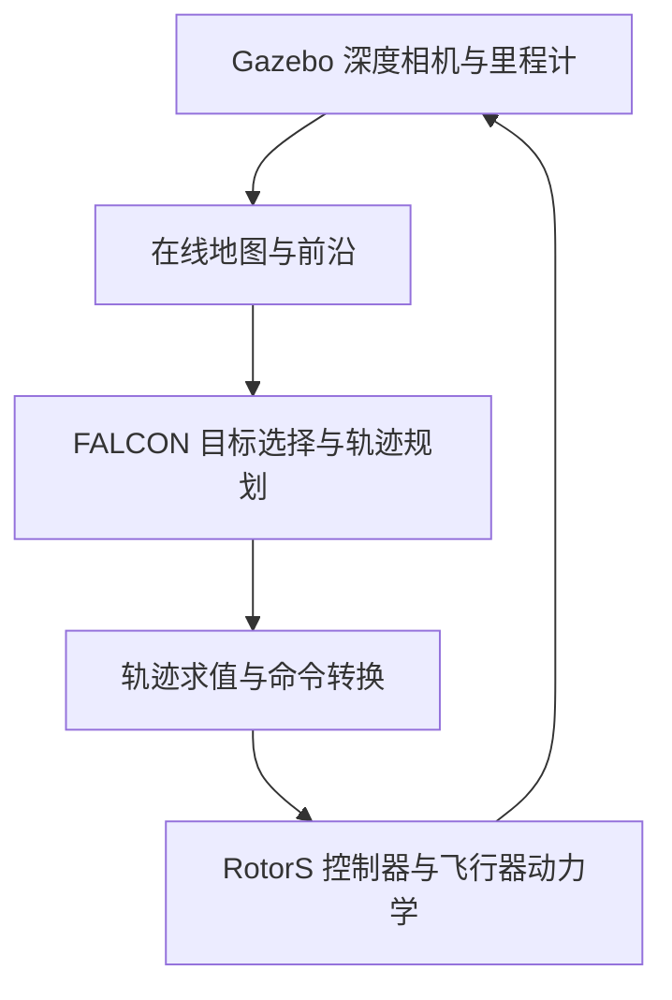

# FALCON Gazebo

**在 ROS Noetic、Gazebo Classic 和 RotorS 中运行 FALCON 无人机自主探索。**

本项目将 [HKUST FALCON](https://github.com/HKUST-Aerial-Robotics/FALCON) 接入 Gazebo 的办公室场景。无人机通过仿真深度相机逐步建图，由 FALCON 选择探索目标、规划轨迹，再由 RotorS 控制器和飞行器动力学执行，使用实际仿真里程计反馈继续规划。

当前 `main` 基于 `v0.3.0-clearance`：包含轨迹时间一致性修正，默认采用本轮测试的避障配置。办公室场景已有两次按原 FALCON 条件完成探索的记录，探索期间均未记录到真实接触。源码、场景、配置和启动入口均保存在本仓库。

[安装与构建](#安装与构建) · [运行探索](#运行探索) · [版本区别](#版本区别) · [测试结果](#测试结果) · [配置与文档](#配置与文档)

## 项目内容

- **FALCON 规划器**：保留原前沿搜索、全局目标选择、局部轨迹规划和探索结束规则。
- **Gazebo / RotorS 接入**：办公室 world、hummingbird 模型、深度相机、真实仿真里程计和轨迹命令转换。
- **统一仿真时间**：传感器、规划与执行使用 ROS `/clock`；保留原轨迹起始时间和求值、切换方式。
- **可对照的历史版本**：保存接入对齐版、时间修正版和避障配置版，便于比较各次改动。
- **运行观察**：保留接触、轨迹和控制过程的观测支撑，方便定位问题。



Gazebo 保存场景的物理几何，规划器根据相机观测持续更新自己的地图。轨迹执行经过飞行器动力学，因此跟随误差、姿态和观测会影响后续规划；运行耗时需要在相同仿真条件下比较。

## 测试结果

以下为 2026-10-27 同一办公室场景、同一套 A 代码和运行程序的既有记录。两组配置仅改变占据判定比例和轨迹优化避障距离。

| 运行 | 占据判定比例 / 避障距离 | 探索时长（ROS 秒） | 实测航程 | 结果 |
| --- | --- | ---: | ---: | --- |
| 原 A 参数对照 | 0.5 / 0.7 m | 68.93 | 102.344 m | 发生真实接触，未完成 |
| 新配置，第 1 次 | 1.5 / 1.0 m | 130.25 | 225.954 m | 原 `FINISH`，探索期间无真实接触记录 |
| 新配置，第 2 次 | 1.5 / 1.0 m | 98.58 | 154.103 m | 原 `FINISH`，探索期间无真实接触记录 |

探索时长从接受开始探索计至首次终止事件，不含启动和起飞准备。`FINISH` 沿用原规划器的可用 active frontier 结束条件；没有通过探索倒计时判定完成。

这些结果说明当前配置在这一批办公室测试中可完成探索，尚不足以说明任意场景或任意重复运行均无碰撞。大型原始 bag / CSV 保存在本地归档中，GitHub 提供源码、结果说明和[记录索引](docs/LOCAL_ARCHIVE_INDEX.md)。

## 版本区别

| 版本 | 主要内容 | 避障配置 |
| --- | --- | --- |
| [`v0.1.0-gazebo-aligned`](https://github.com/cliche71/falcon-gazebo/tree/v0.1.0-gazebo-aligned) | 官方固定版本之上的 Gazebo 接入与参数对齐 | 0.5 / 0.7 m |
| [`v0.2.0-time-consistent`](https://github.com/cliche71/falcon-gazebo/tree/v0.2.0-time-consistent) | 加入轨迹时间一致性修正，简称 **A**，以及配套观测 | 0.5 / 0.7 m |
| [`v0.3.0-clearance`](https://github.com/cliche71/falcon-gazebo/tree/v0.3.0-clearance) | 保持 A 规划代码，默认使用本轮测试的新避障配置 | **1.5 / 1.0 m** |

上游基于固定提交 [`312eb4d`](https://github.com/HKUST-Aerial-Robotics/FALCON/commit/312eb4d32c6c7af1a482f94a0a204aa2bb150cca)。v1 已包含必要的 Gazebo 接入，与上游干净源码存在已记录的差异。

A 修正的是发布阶段曲线时间表示与导数、时长缓存的一致性。它保留原轨迹起始时刻、server 求值和切换方式。

三个标签保存可取回的历史源码，`main` 在 v3 基础上继续维护说明。更换标签后需要重新构建相应程序。具体来源和差异见[版本说明](docs/VERSION_PROVENANCE.md)。

## 安装与构建

### 环境要求

| 项目 | 当前使用环境 |
| --- | --- |
| 操作系统 | Ubuntu 20.04 |
| ROS | ROS Noetic，catkin |
| 仿真 | Gazebo Classic 11，RotorS，hummingbird |
| 主要开发依赖 | Eigen、PCL、OpenCV、NLopt、glog、libdw、jsoncpp，以及 ROS / Gazebo 对应依赖 |
| 运行支撑 | 仓库中的固定控制器与模型观测源码 `support/observation/` |

RotorS、mav_comm 的固定版本记录在 [`config/dependencies.json`](config/dependencies.json)，准备方法见[依赖说明](docs/DEPENDENCIES.md)。当前原生办公室场景的 world / model 已在仓库中；官方示例的大型 PCD、GIF 和预编译资源另有[获取清单](config/resources_manifest.json)。

### 已有运行环境

如果使用原复现电脑，主工作区以及已验证的依赖和程序均已保留，可直接进入下一节运行。普通启动不需要重新克隆或重建。

### 新环境构建

以下是按现有脚本整理的构建顺序，尚未在另一台干净机器上完成整套安装验证。需要先安装 ROS 和开发依赖，并按[固定依赖说明](docs/DEPENDENCIES.md)构建好 RotorS / mav_comm。

克隆本仓库，以下统一以 `~/falcon_gazebo_repair_ws` 为例：

```bash
git clone https://github.com/cliche71/falcon-gazebo.git ~/falcon_gazebo_repair_ws
cd ~/falcon_gazebo_repair_ws
```

环境脚本默认寻找同级的 `~/rotors_ws` 和 `~/falcon_turn_observation_ws`。使用其他位置时，须在构建、启动及操作终端中一致设置 `FALCON_ROTORS_WS`、`FALCON_OBSERVER_WS`。

先构建固定观察支撑，下面的目标目录必须**尚不存在**。已有已验证支撑时跳过此步：

```bash
bash tools/build_observation_support.sh "$HOME/falcon_turn_observation_ws"
```

再构建本仓库：

```bash
bash tools/build.sh
```

构建脚本使用所需包白名单与 `-j2 -l2`。主构建会加载上述支撑环境，因此需要先完成支撑构建。

## 运行探索

以下操作按步骤分别执行。Gazebo 启动、起飞准备和开始探索是三个独立阶段。

### 1. 启动场景与规划器

终端一：

```bash
cd ~/falcon_gazebo_repair_ws
bash tools/start_office.sh gui:=true
```

默认加载新避障配置和 `official_compatible` 深度输入。Gazebo 启动后保持暂停，等待手动操作。多个终端须使用相同的 `ROS_MASTER_URI`；脚本沿用当前设置。

### 2. 解除暂停并确认位置反馈

终端二：

```bash
cd ~/falcon_gazebo_repair_ws
source env.sh
rosservice call /gazebo/unpause_physics '{}'
```

等待传感器和规划节点就绪，确认实际里程计已经有数据：

```bash
rostopic echo -n 1 /hummingbird/odometry_sensor1/odometry/pose/pose/position
```

### 3. 起飞准备

```bash
rosservice call /native/prepare '{}'
```

无人机会准备飞到世界坐标约 `(0, 0, 1)`。查看状态：

```bash
rostopic echo /native/bridge_status
```

等待 `mode` 显示 `READY`，按 `Ctrl+C` 退出查看。`READY` 表示起飞位置和速度已收敛。

### 4. 开始探索

```bash
rosservice call /native/start '{}'
```

每轮调用一次。服务返回成功表示已发出触发；规划器实际接收与执行情况可在终端一的 FSM 日志中查看。探索结束沿用原 FALCON `FINISH` 规则，没有额外的 125 秒或 600 秒探索截止。

### 5. 手动停止

需要停止时单独执行：

```bash
rosservice call /native/stop '{}'
```

该操作使无人机按当前实测位置悬停，不会自动降落，也不算探索完成。停止后需要结束本轮 launch，重新启动场景和规划器，再进行下一轮。

需要查看规划地图与轨迹时，可在加载同一环境的额外终端运行：

```bash
roslaunch exploration_manager rviz.launch
```

## 配置与文档

### 两种避障配置

| 配置 | `sdf_cutoff_distance_scale` | `safe_distance` | 选择方式 |
| --- | ---: | ---: | --- |
| `author_clearance`，当前默认 | 1.5 | 1.0 m | 普通启动 |
| `original_a`，原 A 参数对照 | 0.5 | 0.7 m | 启动时添加 `profile:=original_a` |

使用原 A 参数启动一轮新的仿真：

```bash
bash tools/start_office.sh profile:=original_a gui:=true
```

`original_a` 只选择原避障参数，仍使用 A 代码。更换配置应重新启动仿真与规划器。

1.5 / 1.0 是本项目这一批试验的取值。占据判定比例是 SDF 分类参数；`safe_distance` 是优化中的软避障距离，不能理解成机体半径或整条路线的硬距离保证。

当前地图细分辨率为 0.1 m，规划速度 / 加速度参数为逐轴 2 m/s、3 m/s²。深度相机 near / far 为 0.1 / 500 m，规划深度与地图 raycast 最大距离仍为 5 m。A 基线参数见 [`config/approved_A_parameters.json`](config/approved_A_parameters.json)；当前默认在此基础上覆盖上表两项避障参数。

### 日志

项目记录默认位于 `logs/office_<时间>/`，包括诊断和控制观察目录。ROS 控制台日志由 ROS 自身日志配置管理。可以在启动前指定本轮项目记录目录：

```bash
export FALCON_LOG_DIR="$HOME/falcon_runs/office_$(date +%Y%m%d_%H%M%S)"
bash tools/start_office.sh gui:=true
```

### 源码与说明

| 路径 | 内容 |
| --- | --- |
| [`src/FALCON/`](src/FALCON/) | FALCON 规划与建图源码 |
| [`src/falcon_native/`](src/falcon_native/) | Gazebo 场景、相机接入、里程计与命令转换 |
| [`support/observation/`](support/observation/) | 固定控制器与模型观测支撑源码 |
| [`config/profiles/`](config/profiles/) | 新配置和原 A 对照配置 |
| [`tools/`](tools/) | 构建、启动与可选资源获取 |
| [依赖说明](docs/DEPENDENCIES.md) | 依赖来源、固定版本与支撑构建 |
| [版本说明](docs/VERSION_PROVENANCE.md) | 三个历史版本的来源与改动 |
| [已知限制](docs/KNOWN_LIMITATIONS.md) | 动态约束、轨迹衔接和探索终态的已知问题 |
| [本地记录索引](docs/LOCAL_ARCHIVE_INDEX.md) | 历史实验与原始记录的保存位置 |

## 已知限制

- 当前验证集中在办公室场景，其他场景需要重新测试。`FINISH` 表示原可用前沿结束条件，不代表每个可达体素都已观测。
- 原短段异常重算、最终动态约束和轨迹衔接问题仍有记录；即使参数设置为 2 m/s、3 m/s²，最终命令也可能超过这些值。详细数值保存在[已知限制](docs/KNOWN_LIMITATIONS.md)中。
- RotorS 的轨迹跟随误差和姿态变化会影响探索过程，因此本仓库结果不能直接当作与论文原仿真同条件的速度比较。

## 上游项目与论文

本项目基于以下工作，研究使用请引用原论文：

**FALCON: Fast Autonomous Aerial Exploration Using Coverage Path Guidance**  
Yichen Zhang, Xinyi Chen, Chen Feng, Boyu Zhou, Shaojie Shen.  
IEEE Transactions on Robotics. [正式论文 / DOI](https://doi.org/10.1109/TRO.2024.3522148) · [官方仓库](https://github.com/HKUST-Aerial-Robotics/FALCON) · [上游说明与 BibTeX](src/FALCON/README.md)

飞行器仿真依赖 [RotorS](https://github.com/ethz-asl/rotors_simulator) 和 [mav_comm](https://github.com/ethz-asl/mav_comm)。各部分代码保留原来源与版权说明，详见 [THIRD_PARTY_NOTICES.md](THIRD_PARTY_NOTICES.md)。
